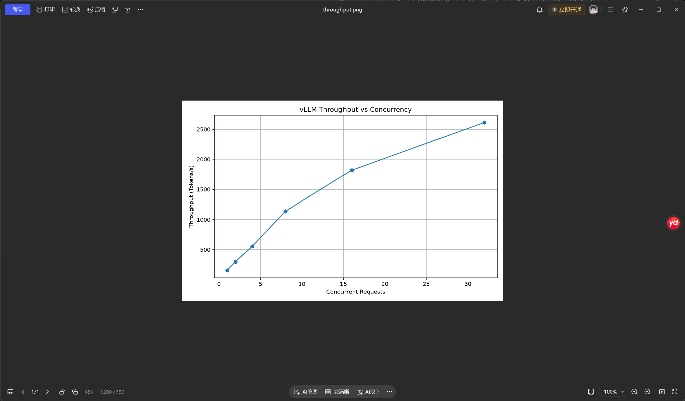
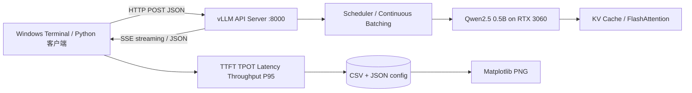

# ⚡ LLM Inference Benchmark

> [!abstract] 一句话介绍
> 在 **Windows 11 + WSL2 Ubuntu + RTX 3060 Laptop 6GB** 上，从零部署 **Qwen2.5-0.5B-Instruct + vLLM 0.32.0**，构建支持 **TTFT / TPOT / 吞吐量 / P95 / 错误计数 / CSV / JSON / 曲线图** 的推理压测原型。完整记录一名 Python/Linux 初学者的部署、调试与性能分析过程。



   

> [!important] 关于数据真实性
> 本仓库中的**历史结果**来自学习对话中的实际终端截图；`src/` 为基于当时功能整理出的**可复现、带必要改进的代码版本**，并非声称逐字等同于用户电脑上的原始文件。没有获得原始全部脚本、原始 CSV 或模型权重，因而没有伪造这些文件。截图内可能出现本地用户名或计算机名，公开发布前请检查隐私。

## 🧭 阅读入口

| 我想做什么 | 从这里开始 |
|---|---|
| 快速了解项目和亮点 | **当前 README** |
| 跟着时间线复盘从零开始的全过程 | [01 · 项目时间线](docs/01-项目全流程复盘.md) |
| 在自己机器上复现 | [02 · 环境与部署](docs/02-环境与部署复现.md) → [03 · Benchmark 代码导读](docs/03-代码逐模块精读.md) |
| 复习 Linux / Python / WSL / HTTP 基础 | [04 · 基础知识手册](docs/04-基础知识随查.md) |
| 遇到安装/代码错误 | [05 · 真实报错实录](docs/05-错误排查案例库.md) |
| 阅读真实实验、数据和限制 | [06 · 实验与性能分析](docs/06-实验记录与严谨性.md) |
| 准备面试 / GitHub 展示 | [07 · 工程化与求职表达](docs/07-工程化与求职表达.md) |
| 确认哪个截图讲了什么 | [08 · 截图索引与复盘清单](docs/08-截图索引与复盘清单.md) |

## 🏗️ 架构概览



**关键认识：** Transformer 是**模型架构**，Transformers 和 vLLM 是两种**推理软件栈**。vLLM 并不让模型“更聪明”，而是优化推理服务的计算、调度及内存管理。

## 📊 真实实验快照

| 场景 | 当时记录 | 解释 |
|---|---:|---|
| Windows Transformers 基线 | 14.59 output tokens/s | 历史 5 轮测试，约 348 tokens/轮；与新环境并非严格对照 |
| vLLM 单请求（早期） | 189.14 output tokens/s | 371 tokens，2 轮预热 + 5 轮正式 |
| vLLM Streaming | TTFT 55.7 ms，TPOT 5.29 ms | 客户端测量；5 轮 |
| 并发 8（一次实验） | 1310.53 total output tokens/s | 8 × 256 tokens |
| 并发 32（一次实验） | 3186.14 total output tokens/s | 32 × 256 tokens |
| 并发 128（一次实验） | 7732.84 total output tokens/s | 128 × 256 tokens；并非单用户速度 |
| 平台正式模式 1 | 151.07 ± 5.90 tokens/s | P95 1.782 s；TTFT 41.72 ms；TPOT 6.48 ms |
| 平台正式模式 32 | 2392.83 ± 102.50 tokens/s | P95 3.535 s；TTFT 222.64 ms；TPOT 12.37 ms |

> [!warning] 不要把“约 13×”写成严谨结论
> `189.14 / 14.59 ≈ 12.96` 只是**不同实验配置下的观察比值**。Windows/WSL、推理设置、输入长度、输出数量、计时范围等尚未对齐；无法据此证明“vLLM 纯粹加速 13 倍”。详情见 [实验与性能分析](docs/06-实验记录与严谨性.md)。

## 🚀 复现最短路径

> 已经在 Linux 中配置好支持 CUDA 的 NVIDIA 驱动 / WSL GPU，且有可访问 Hugging Face 的网络条件后：

```bash
# 1. 创建并进入目录
mkdir -p ~/aiinfra-vllm && cd ~/aiinfra-vllm
# 2. 创建 Python venv 并激活
python3 -m venv .venv
source .venv/bin/activate
# 3. 安装 vLLM（以官方当前兼容矩阵为准）
python -m pip install uv
uv pip install vllm --torch-backend=auto
# 4. 启动本地模型服务（历史版本用于 RTX 3060 的已验证配置）
VLLM_USE_FLASHINFER_SAMPLER=0 vllm serve Qwen/Qwen2.5-0.5B-Instruct \
  --dtype float16 --max-model-len 1024 \
  --gpu-memory-utilization 0.65 --max-num-seqs 32
```

另开一个 Ubuntu 终端：

```bash
curl -i http://localhost:8000/health
# 在本仓库根目录（src 版本不依赖额外第三方库进行测试）
python3 src/main.py
python3 -m pip install matplotlib  # 必须在已激活的 venv 内
python3 src/plot_results.py results/你实际生成的文件.csv
```

更详细的每项命令和硬件注意事项见 [部署文档](docs/02-环境与部署复现.md)。**不要**在 WSL 里安装 NVIDIA Linux 内核驱动；驱动来自 Windows 宿主机。对于版本不同的 vLLM，历史环境变量的兼容性需要重新验证。

## 🗂️ 目录结构

```text
AIInfra-LLM-Benchmark/
├── README.md                    # 公开首页 + 学习导航
├── docs/                        # 复盘教程、错误案例、实验分析
├── src/
│   ├── main.py                  # 统一入口 + 并发 + 流式指标 + CSV/JSON
│   └── plot_results.py          # 四张性能曲线
├── assets/
│   ├── screenshots/             # 对话中真实运行截图（精选）
│   └── figures/                 # 可视化示意
├── examples/                    # 历史实验快照（非原始 CSV）
├── requirements.txt
├── .gitignore
└── LICENSE
```

## 🧪 一句话复盘

> 从“`python` 和 `python3` 有何区别”开始，最终理解了 **模型服务、操作系统、网络代理、GPU 推理、I/O 并发、性能统计和工程化交付** 之间的关系。项目最有价值的不是一个吞吐量峰值，而是完整的**定位问题 → 改动系统 → 验证 → 记录证据**的过程。

## 🔗 参考与许可

- [vLLM 官方文档](https://docs.vllm.ai/)
- [vLLM Benchmark 官方说明](https://github.com/vllm-project/vllm/blob/main/docs/benchmarking/cli.md)
- [Qwen2.5-0.5B-Instruct](https://huggingface.co/Qwen/Qwen2.5-0.5B-Instruct)
- [Microsoft WSL 网络指南](https://learn.microsoft.com/windows/wsl/networking)
- [AIInfraGuide 学习路线（页面结构灵感；内容独立编写）](https://caomaolufei.github.io/AIInfraGuide/guides/ai-infra学习路线/)

本仓库示例代码采用 MIT License，第三方模型和工具请分别遵守其许可证。
