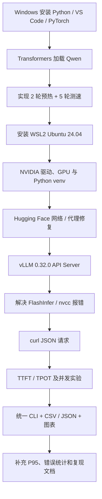
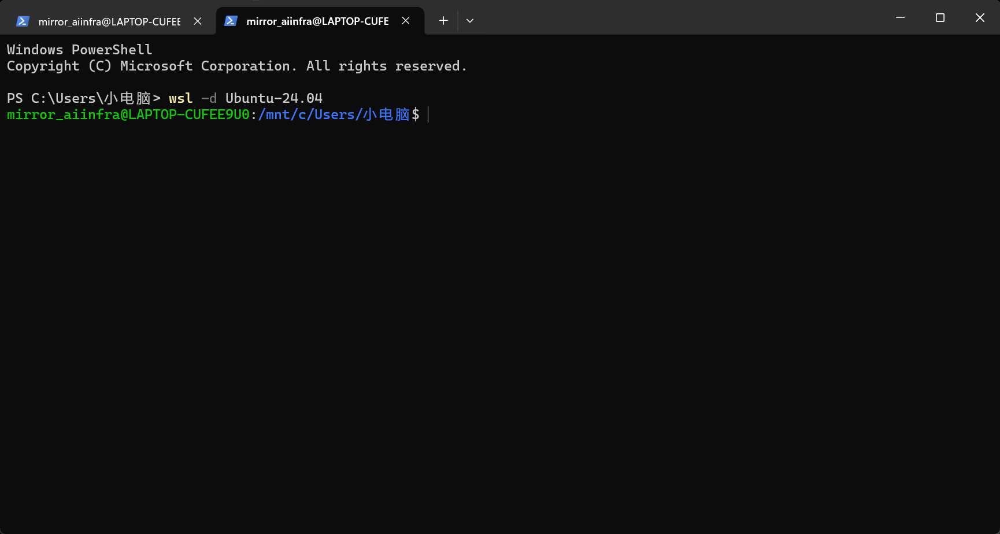
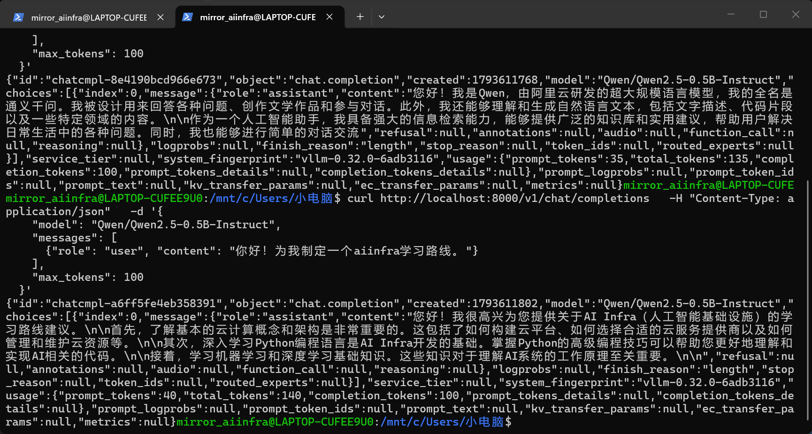
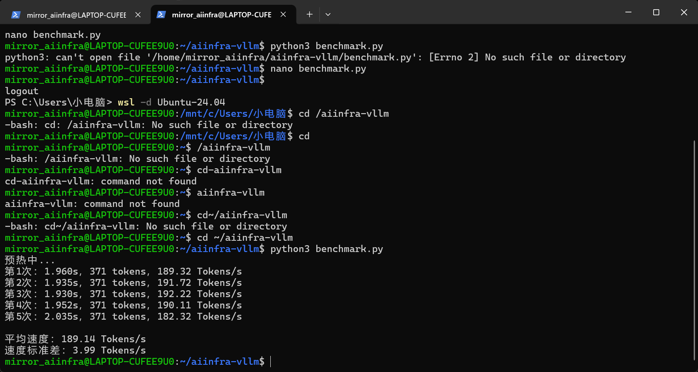
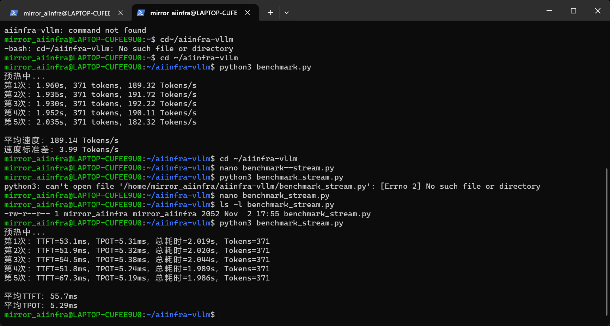
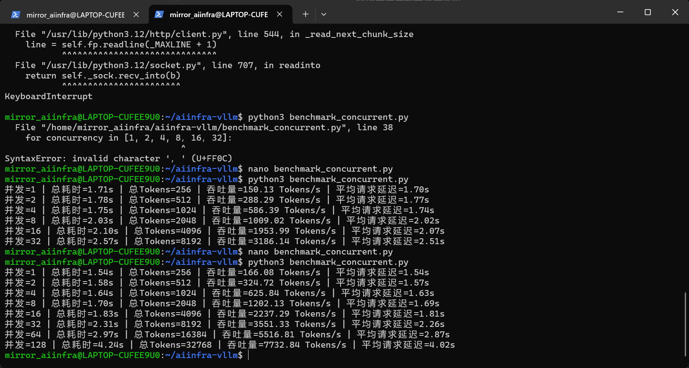
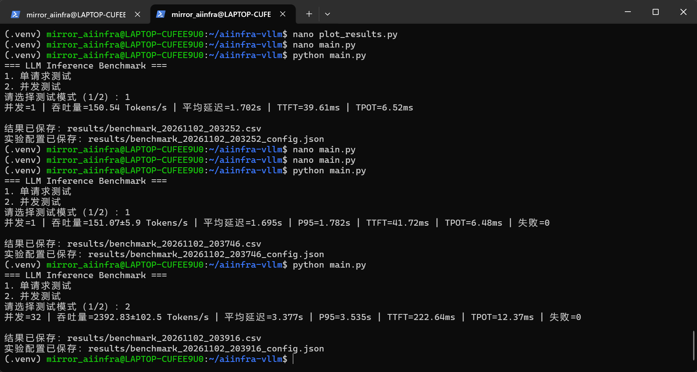

# 01｜从 0 到 vLLM Benchmark：项目全流程复盘

> [!tip] 阅读方式
> 这是**学习笔记**，按真实发生的先后顺序写。每一关都包含「做了什么 → 为什么 → 常见错误 → 证据」。需要复制部署命令请转到 [[02-环境与部署复现]]。

## 项目学习路线图



## 第一站｜为什么做这个项目？

目标不是训练大模型，而是在有限 GPU 上**测量、理解并优化推理服务**。从 Python 初学者出发，先建立可运行基线，再引入 vLLM，逐步增加观测能力、并发能力和可复现性。

### Windows 阶段：最先跑通的 Qwen

- Windows 11；Python **3.12.10**，安装目录曾为 `D:\Python312_AI`；项目目录曾为 `D:\llm-inference-benchmark`。
- Windows venv：`.venv`；PyTorch **2.5.1 + cu121**，Transformers **4.46.3**，Accelerate **1.1.1**；模型 `Qwen/Qwen2.5-0.5B-Instruct`。
- GPU：**RTX 3060 Laptop 6GiB**。通过 `torch.cuda.is_available()` 判断是否有可用 CUDA；用 `.to('cuda')` 将模型张量迁入显存。
- 已理解 `AutoTokenizer`、`AutoModelForCausalLM`、`torch.float16`、`model.generate()`、`max_new_tokens`、`input_ids` 与 `torch.cuda.synchronize()`。

> [!note] 当时最重要的顿悟
> GPU 是硬件；CUDA 是 NVIDIA GPU 计算平台 / 软件栈；PyTorch 是调用 CUDA 的框架；Transformers 是高层模型库；Qwen 是模型。它们不是同一种东西。

### 首轮 Benchmark 数据

| 测试 | 观察 |
|---|---|
| 冷启动附近的一轮 | 54 tokens / 11.227 s / 4.81 tokens/s |
| 2 次预热 + 5 次（54 tokens） | 平均 **4.070 s / 13.29 tokens/s** |
| 更长回答（约 348 tokens） | 平均 **23.865 s / 14.59 tokens/s** |
| 长输入场景 | 约 12 tokens/s，提示 Prefill 及上下文影响 |

讨论过：预热消除首次执行开销；输入更多时 Prefill 增加；“题目语义更难”不必然增加同样长度输出的 Decode 时间；输出上限不能代替自然 EOS 停止。

## 第二站｜从 Windows 到 Ubuntu

为什么转 Linux：vLLM 的常见生产部署和性能开发环境以 Linux 为主，WSL2 能在 Windows 上提供真实 Linux 用户态 / 内核兼容环境。

- Ubuntu **24.04.5 LTS**，WSL2，发行版安装位置选择 `D:\WSL\Ubuntu`。
- Linux 用户：`mirror_aiinfra`；Linux 项目目录：`~/aiinfra-vllm`；虚拟环境：`~/aiinfra-vllm/.venv`。
- Linux Python **3.12.3**。
- Windows NVIDIA Studio Driver 后续升级至 **617.42**；WSL `nvidia-smi` 识别 RTX 3060；不要在 WSL 中另装 Linux NVIDIA kernel driver。

### 关于目录的重要问题

```text
C:\Users\<WindowsUser>  ↔  /mnt/c/Users/<WindowsUser>
/home/mirror_aiinfra     ↔  WSL Linux 家目录（不是 Windows C 盘目录）
```

进入 WSL 时如果从 PowerShell 的 Windows 当前目录启动，终端最初可能显示 `/mnt/c/Users/...`；`cd ~` 才回到 Linux 家目录。**提示符显示的是当前工作目录，不等于系统安装目录。**



## 第三站｜第一个真正难点：网络不通

第一次 `vllm serve` 失败：

```text
[Errno 101] Network is unreachable
Could not connect to https://huggingface.co
... files not found in local cache
```

Ubuntu `curl -I https://www.microsoft.com` 返回 200，但 `curl -I https://huggingface.co` 失败。故不是“Ubuntu 完全没网”，而是特定目的地无法访问。

用户当时使用 Windows 代理客户端（日本节点、规则模式）；Windows 配了本机代理端口 `7890`，但 WSL 起初处于 NAT 网络模式，无法直接使用 Windows 的 `localhost` 代理。

修改 `%USERPROFILE%\.wslconfig`：

```ini
[wsl2]
networkingMode=mirrored
autoProxy=true
dnsTunneling=true
```

随后在 **Windows PowerShell** 执行 `wsl --shutdown`，重新进入 Ubuntu；`env | grep -i proxy` 显示 `https_proxy=http://127.0.0.1:7890`，再 `curl -I https://huggingface.co` 返回 `HTTP/1.1 200 Connection established` 和 `HTTP/2 200`。

> [!important] 底层解释
> NAT / Mirrored 决定两个系统的网络连接关系；代理监听端口并代替客户端访问目标站点；`autoProxy` 让 WSL 接收 Windows 的代理配置；`dnsTunneling` 改善域名解析协作。三者分工不同。下载之后的**本地推理**不依赖外网或代理。

## 第四站｜启动 vLLM 的第二道坎：FlashInfer / nvcc

模型已经成功下载并加载，显存足够，服务却在预热中报错：

```text
RuntimeError: Could not find nvcc and default cuda_home='/usr/local/cuda' doesn't exist
Engine core initialization failed
```

原理：NVIDIA **驱动 / CUDA runtime** 与 **CUDA Toolkit 编译器 nvcc** 是不同组件。某些 FlashInfer 路径需要编译或预编译算子。最终通过运行时关闭 FlashInfer sampler，保留 GPU 和 FlashAttention 2，完成启动：

```bash
VLLM_USE_FLASHINFER_SAMPLER=0 vllm serve Qwen/Qwen2.5-0.5B-Instruct \
  --dtype float16 --max-model-len 1024 \
  --gpu-memory-utilization 0.65 --max-num-seqs 1
```

成功日志中的关键行：

```text
FlashInfer top-p/top-k sampling disabled via VLLM_USE_FLASHINFER_SAMPLER=0.
Using FlashAttention version 2
Available KV cache memory: 2.58 GiB
Starting vLLM server on http://0.0.0.0:8000
Application startup complete.
```

> [!warning] 不能把 `VLLM_USE_FLASHINFER_SAMPLER=0` 单独当作已生效的配置
> `VAR=0` 独立一行只是当前 Shell 变量；`VAR=0 command` 在启动命令时传给子进程；`export VAR=0` 才会影响后续启动的子进程。历史上因此多走过一次弯路。

## 第五站｜从脚本到 API 服务

一个终端跑服务端；另一个 Ubuntu 终端用 `curl` 发送请求。`/health` 返回 `HTTP 200`；`/v1/chat/completions` 接收 JSON，返回带 `usage.completion_tokens` 的 JSON。



初始回答把 `max_tokens=100` 用满，`finish_reason=length`。这表明回答被截断：**输出快也可能只是因为少输出**。

## 第六站｜从耗时到 TTFT、TPOT

开始只用 `curl -w '%{time_total}'` 记录一次 HTTP 请求耗时（看到约 **1.077520 s**），后来 Python `time.perf_counter()` 测量 2 次预热 + 5 次重复。

早期运行：每次 **371** 输出 tokens，五次平均 **189.14 tokens/s**；标准差 **3.99 tokens/s**。Streaming 指标平均 **TTFT 55.7 ms、TPOT 5.29 ms**。




### 两条重要公式

$$\mathrm{Throughput} = \frac{\sum_i \mathrm{output\ tokens}_i}{\mathrm{batch\ wall\ time}}$$

$$\mathrm{TPOT}_i \approx \frac{\mathrm{Latency}_i - \mathrm{TTFT}_i}{\mathrm{output\ tokens}_i-1}$$

TTFT 实际记录的是**客户端收到第一个非空文本流式片段**的时间；这不是纯 GPU kernel 时间。后续文本片段未必严格每块一个 token。

## 第七站｜并发从 1 → 128

Python `ThreadPoolExecutor` 同时发请求，vLLM `--max-num-seqs` 决定可同时调度的序列上限，服务端 Continuous Batching 合批进行推理。并发不是启动 128 个模型。



实际单轮观察：1 并发 **166.08**，8 并发 **1202.13**，32 并发 **3551.33**，64 并发 **5516.81**，128 并发 **7732.84** total output tokens/s。并发高了，总吞吐量提高，但平均完成时延从约 1.54 s 升至 4.02 s。

> [!tip] 提问复盘
> 为什么并发 128 时“速度还更快”？因为**总吞吐量**是在所有用户之间求和；**单请求延迟**已经变慢。两者不是同一个量。

## 第八站｜形成工具原型

从分散的 `benchmark.py`、`benchmark_stream.py`、`benchmark_concurrent.py` 逐步整合为 `main.py`：

- 交互式选择单请求 / 并发测试；
- 汇总吞吐量、延迟、客户端 TTFT、TPOT；
- 5 次重复；P95、吞吐量标准差、失败次数；
- `results/*.csv` 保存数值、`*_config.json` 保存测试条件；
- `plot_results.py` + `matplotlib` 画四项性能曲线。

最终一次模式 1：**151.07 ± 5.90 tokens/s**，平均延迟 **1.695 s**、P95 **1.782 s**、TTFT **41.72 ms**、TPOT **6.48 ms**、失败 **0**。

模式 2 中并发 32：**2392.83 ± 102.50 tokens/s**，平均延迟 **3.377 s**、P95 **3.535 s**、TTFT **222.64 ms**、TPOT **12.37 ms**、失败 **0**。



> [!summary] 一句话成长记录
> 从单模型 `.generate()` 到一个能被调用、并发运行、测量、存档并可视化的推理服务评估工具——中间真正学到的是跨越 Python、Linux、网络、GPU、HTTP、服务调度与性能统计的系统思维。
