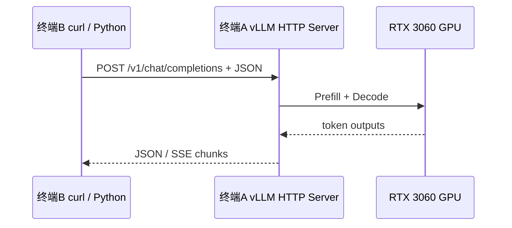

# 02｜环境、安装与部署：从空机器到可请求的 vLLM

> [!warning] 复现边界
> 以下复盘针对 2026-11-02 的历史成功环境，并非保证所有新版依赖都完全兼容。请先检查 [vLLM 官方安装指南](https://docs.vllm.ai/)；6 GiB 显存属于较紧张的环境。所有命令都是示例，不包含账户令牌。

## 1. 环境卡片

| 项目 | 记录 |
|---|---|
| OS | Windows 11 + WSL2 Ubuntu 24.04.5 LTS |
| Windows Python | 3.12.10（历史路径 `D:\Python312_AI`） |
| WSL Python | 3.12.3；venv `.venv` |
| GPU | NVIDIA GeForce RTX 3060 Laptop, 6 GiB VRAM |
| NVIDIA Windows Driver | Studio Driver 617.42（升级后的历史结果） |
| vLLM | 0.32.0 |
| Qwen | `Qwen/Qwen2.5-0.5B-Instruct` |
| dtype | FP16，模型原始 BF16 参数被转换 |
| kv cache | 历史日志约 2.58 GiB 可用；模型权重约 0.93 GiB |

## 2. Windows 先确认 WSL 与 GPU

PowerShell：

```powershell
wsl --list --verbose
wsl -d Ubuntu-24.04
```

`wsl` 调用 Linux 子系统；`--list --verbose` 查看发行版及版本；`-d` 指定发行版。

Ubuntu：

```bash
cat /etc/os-release
python3 --version
nvidia-smi
```

`cat` 输出文件内容；`/etc/os-release` 是 Linux 发行版资料；`python3 --version` 查询解释器版本；`nvidia-smi` 查看 GPU/驱动状态。

> [!caution] 不要在 WSL2 安装 Linux NVIDIA GPU 内核驱动
> WSL GPU 驱动由 Windows 驱动提供 Linux 接口。在 Ubuntu 内再次安装内核驱动可能导致冲突；CUDA Toolkit 与驱动不是同一事物。

## 3. 建立 Python 项目隔离环境

```bash
sudo apt update
sudo apt install -y python3-pip python3-venv
mkdir -p ~/aiinfra-vllm
cd ~/aiinfra-vllm
python3 -m venv .venv
source .venv/bin/activate
which python
python --version
```

- `sudo` 临时以管理员身份运行；`apt update` 更新包索引；`install -y` 安装并自动确认。
- `mkdir -p` 创建目录，已存在不报错；`~` 表示 Linux 用户家目录；`cd` 切换工作目录。
- `python3 -m venv .venv`：使用 Python 的 `venv` 模块创建隔离环境；`-m` 是“按模块运行”。
- `source .venv/bin/activate`：把 venv 的 `bin/` 放到当前 Shell 的命令搜索路径前端；`.venv` 是隐藏目录（名字以点开头）。
- `which python` 显示实际命中的 Python 可执行路径。**激活后 `python` 和 `python3` 一般都在 `.venv/bin/` 中。**

## 4. 安装 vLLM

```bash
python -m pip install uv
uv pip install vllm --torch-backend=auto
vllm --version
```

`pip install uv` 安装包管理器；`uv pip install` 将依赖装入当前虚拟环境；`--torch-backend=auto` 根据环境选择 PyTorch 后端（历史命令）；具体支持请以当时版本和官方文档为准。

## 5. 代理 / Hugging Face 下载疑难

第一次模型下载报：

```text
[Errno 101] Network is unreachable
can't connect to huggingface.co
```

先诊断 **DNS / 目标连通性 / 代理**，而不是重装 vLLM：

```bash
curl -I --max-time 10 https://www.microsoft.com
curl -I --max-time 10 https://huggingface.co
env | grep -i proxy
```

- `curl -I`：只请求响应头；`--max-time 10`：最多 10 秒。
- `env` 列出环境变量；`|` 管道，把输出交给下一条命令；`grep -i proxy` 不区分大小写地筛选代理变量。

历史上 Windows 代理端口为 `7890`。配置 `C:\Users\<WindowsUser>\.wslconfig`：

```ini
[wsl2]
networkingMode=mirrored
autoProxy=true
dnsTunneling=true
```

**PowerShell** 执行 `wsl --shutdown` 后重新 `wsl -d Ubuntu-24.04`，再在 Ubuntu 中 `curl -I https://huggingface.co` 得到 HTTP 200。

> [!note] Windows / WSL 的 localhost
> 在 WSL NAT 模式下，Linux 的 `127.0.0.1` 不能理所当然访问 Windows 进程；镜像模式改善了跨环境的本机访问。`autoProxy` 传播代理设置，并不等于把国内所有流量强制送往国外。

## 6. 模型服务启动

```bash
VLLM_USE_FLASHINFER_SAMPLER=0 vllm serve Qwen/Qwen2.5-0.5B-Instruct \
  --dtype float16 \
  --max-model-len 1024 \
  --gpu-memory-utilization 0.65 \
  --max-num-seqs 32
```

| 参数 | 语义 | 备注 |
|---|---|---|
| `vllm serve` | 启动长驻模型 API 服务 | 不会执行完立刻回提示符 |
| `Qwen/...` | Hugging Face 仓库 ID | 也可使用完整本地模型目录 |
| `--dtype float16` | FP16 推理 | 不是量化 |
| `--max-model-len 1024` | 每条序列上下文长度上限 | 输入 + 输出受该上限约束 |
| `--gpu-memory-utilization 0.65` | vLLM 的显存预算比率 | 不是任意时刻都用掉 65% |
| `--max-num-seqs 32` | 调度并发序列上限 | 不等于同时产生 32 个请求 |
| `VAR=0 command` | 仅为本次命令设置环境变量 | 当前版本的 FlashInfer sampler workaround |
| 行尾 `\` | Bash 续行符 | 不要在反斜杠后留空格 |

历史上直接启动曾因 `nvcc` 缺失、FlashInfer sampler JIT 失败；上述运行时开关使服务正常启动，但**不能保证后续所有 vLLM 版本继续支持同一开关**。

## 7. 双终端：服务端与客户端



第二个 Ubuntu 终端（**无需激活 venv 就能用 curl**）：

```bash
curl -i http://localhost:8000/health
```

`-i` 同时显示 HTTP 响应头。应看到 `HTTP/1.1 200 OK`。如果连接失败，检查第一个终端是否真的完成初始化、有没有退出，**仅看到 vLLM banner 不够**。

提交问题：

```bash
curl http://localhost:8000/v1/chat/completions \
  -H 'Content-Type: application/json' \
  -d '{"model":"Qwen/Qwen2.5-0.5B-Instruct","messages":[{"role":"user","content":"你好，请介绍自己"}],"max_tokens":128}'
```

`-H` 指定 HTTP 头；`-d` 提供 JSON 请求正文，意味着 POST。使用单引号包住 JSON 是为了让 Bash 不解释 JSON 的双引号。

## 8. 运行本仓库工具

将本仓库克隆或拷贝到 Ubuntu 内 Linux 文件系统，进入仓库根目录后：

```bash
python src/main.py
python -m pip install -r requirements.txt
python src/plot_results.py results/实际结果文件.csv
explorer.exe charts
```

`-r` 按依赖文件安装；`explorer.exe charts` 从 WSL 启动 Windows 文件资源管理器打开绘图目录。若使用 WSL Linux 工作目录而非 `/mnt/c/`，文件通常读写速度更适合开发。

## 9. 复现检查表

- [ ] `nvidia-smi` 可识别 GPU
- [ ] 虚拟环境 `which python` 指向 `.venv/bin/python`
- [ ] `vllm --version` 可运行
- [ ] `/health` 返回 200
- [ ] `/v1/chat/completions` 能返回 JSON 和 `usage`
- [ ] 1、2、4、8、16、32 并发能生成结果
- [ ] CSV、配置 JSON、PNG 都能在磁盘看到
