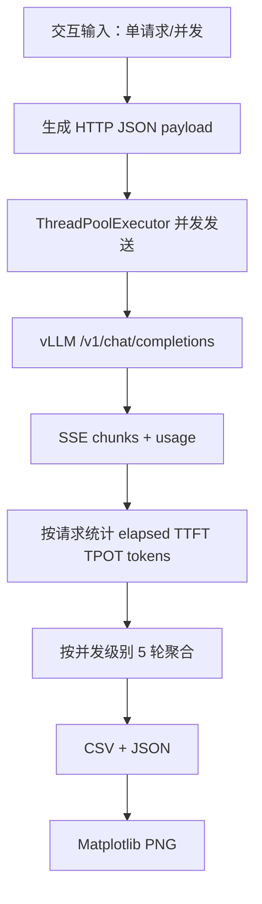

# 03｜逐模块读懂 Benchmark：代码不是魔法

> [!info] 代码定位
> `src/main.py` 是根据学习期间的 `main.py` 功能整理的**增强复现版**：修复了部分异常与测量边界问题；不是原始文件逐字复制。阅读时对照源代码并实际修改一两个变量。

## 0. 数据流（先读图）



## 1. 导入与常量

```python
import json, csv, time, statistics
from concurrent.futures import ThreadPoolExecutor
from pathlib import Path
```

- **模块**：已有功能的代码集合。
- `from ... import ...`：只导入需要的类/函数；`ThreadPoolExecutor` 是线程池管理类。
- `URL`、`MODEL`、`PROMPT`、`MAX_TOKENS` 定义在顶部，把“可变的测试条件”与“固定逻辑”分开。

## 2. `send_request(i)`：一次请求的完整生命周期

```python
payload = {
    'model': MODEL,
    'messages': [{'role': 'user', 'content': f'用户{i}：{PROMPT}'}],
    'max_tokens': MAX_TOKENS,
    'temperature': 0,
    'stream': True,
    'stream_options': {'include_usage': True},
}
```

**为什么需要这个字典？** API 需要知道模型、聊天内容、输出限制与生成策略；`stream=True` 允许边生成边接收；`include_usage` 让末尾提供实际 token 数量。

```python
body = json.dumps(payload, ensure_ascii=False).encode('utf-8')
request = urllib.request.Request(URL, data=body, headers={
    'Content-Type': 'application/json'
})
```

- `dumps`：字典 → JSON 字符串。
- `encode('utf-8')`：字符 → 网络可发送的字节。
- `Request`：构造 HTTP 请求；`data` 非空时默认发 POST。

```python
start = time.perf_counter()
with urllib.request.urlopen(request, timeout=120) as response:
    for raw_line in response:
        ...
```

`perf_counter` 用来计算差值，不能当作“当前日期”。`with` 负责关闭响应对象；`for ... in response` 等待接收流式数据。

### SSE 的 `data:` 事件

```text
data: {"choices":[{"delta":{"content":"你好"}}]}

data: {"choices":[],"usage":{"completion_tokens":42}}

data: [DONE]
```

真实响应还会包含许多元数据。程序只解析 `data:` 开头的事件，忽略空行；`[DONE]` 是结束标记。`chunk['choices'][0]['delta']` 可能带文本，也可能只有 role 或空内容，不能无条件当作首 token。

### 时间指标

```python
ttft = first_content_at - start
latency = last_stream_at - start
tpot = (latency - ttft) / (generated_tokens - 1)
```

如果只返回 0 或 1 个 token，TPOT 应设为缺失。TTFT 是**客户端首个非空文本块**到达的时间；不是纯 GPU 推理时钟。

> [!warning] 历史脚本的一个细节
> 最初用 `end = perf_counter()` 在读完 `[DONE]` 后计时，因此包含尾部响应与 usage 传输开销。增强复现版记录最后一个文本事件时间，用于 TPOT 和完成时间估算；与此同时仍保留 HTTP 总耗时以便观察额外开销。这两者定义不同，**跨版本比较时必须写清楚测量边界**。

## 3. `ThreadPoolExecutor`：是谁制造并发？

```python
with ThreadPoolExecutor(max_workers=concurrency) as pool:
    results = list(pool.map(send_request, range(concurrency)))
```

1. `range(4)` 生成 `0,1,2,3`；
2. `pool.map(send_request, ...)` 提交 4 项任务；
3. 多个线程在等待 HTTP I/O 时可以切换运行；
4. `list(...)` 消费结果；
5. 离开 `with` 自动 `shutdown(wait=True)`。

这**不等于 GPU 启动了 4 个模型实例**；服务端如何合批是 vLLM scheduler 的职责。`max_workers` 只限制客户端同时工作线程数量。

## 4. 指标聚合与统计

```python
total_output_tokens = sum(r['tokens'] for r in successful)
throughput = total_output_tokens / batch_wall_seconds
```

分子为**全部成功请求的输出 tokens**；分母为**整批实际流逝时间**。即使每个请求只达到 150 tokens/s，总吞吐量也能随批处理显著增长。

```python
statistics.mean(values)
statistics.stdev(values)
```

第一项是均值；第二项是样本标准差，至少需要 2 个样本。注意对 5 轮的吞吐量求标准差，而不是对本来不同并发水平的指标混合求标准差。

### P95：不要把“均值”误当“95% 体验”

```python
import math
ordered = sorted(latencies)
p95 = ordered[max(0, math.ceil(len(ordered) * 0.95) - 1)]
```

这是**nearest-rank** 定义。若有 160 条成功请求，则取排序后的第 152 项（索引 151）；相当于 95% 的样本延迟不大于这个值。样本量小（比如单请求模式只有 5 条）时不稳定，应标注样本数。

## 5. `try/except`：失败也是数据

不能因为一个请求失败就直接“当没有发生过”；应记录失败数和失败类型。**失败请求也会拖慢整批完成时间，不能把计时分母只算成功请求的内部 elapsed**。增强版保留实际 batch wall time；且若整轮全部失败，不把 0 tokens/s 伪装成有效性能。

## 6. CSV、JSON 与绘图

```python
with open(csv_path, 'w', newline='', encoding='utf-8') as f:
    writer = csv.DictWriter(f, fieldnames=COLUMNS)
    writer.writeheader()
    writer.writerows(rows)
```

CSV 适合数值表；JSON 更适合分层参数，如模型、采样、服务端配置、时间戳和平台说明。`newline=''` 让 `csv` 模块处理换行；`ensure_ascii=False` 保留中文；`indent=2` 提升可读性。

绘图模块：`matplotlib.use('Agg')` 在没有桌面的 Ubuntu 中直接写 PNG；`csv.DictReader` 按列名读取，`plt.savefig` 保存。

## 7. 建议动手练习

- [ ] 将 `PROMPT` 改为另一个问题，并检查 `completion_tokens` 是否变化
- [ ] 把并发测试列表改为 `[1,3,5,10]`，证明不必是 2 的幂
- [ ] 让 vLLM 服务停止后执行客户端，验证失败次数如何记录
- [ ] 打开 CSV，对照 `throughput=total_tokens/batch_wall_seconds`
- [ ] 用 `curl` 测量 `/health` 和 `/v1/chat/completions` 的区别
- [ ] 找出 P95 的样本计算方式，解释它为什么不是平均值
