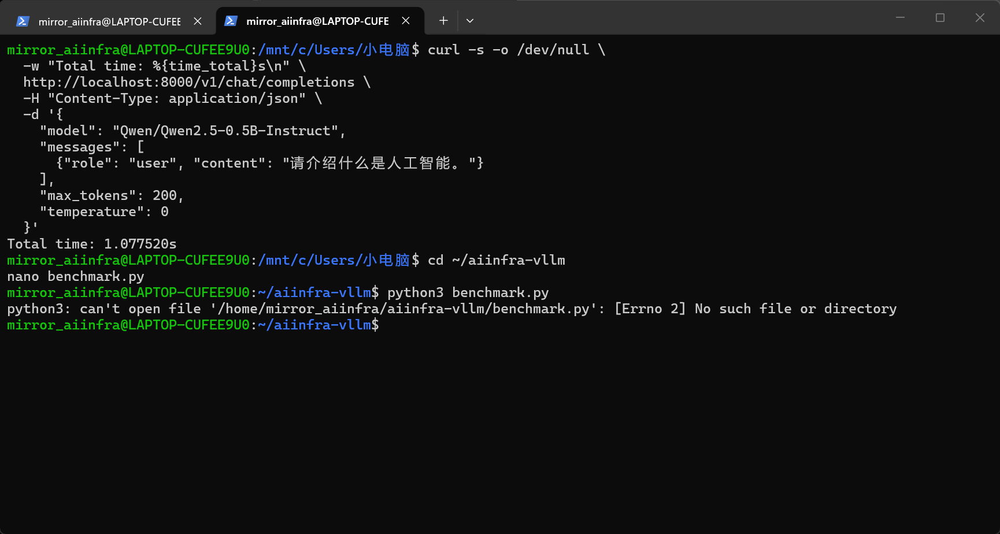
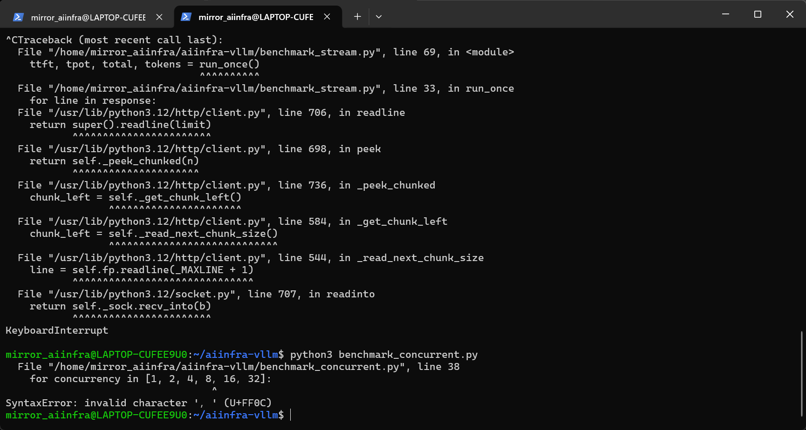
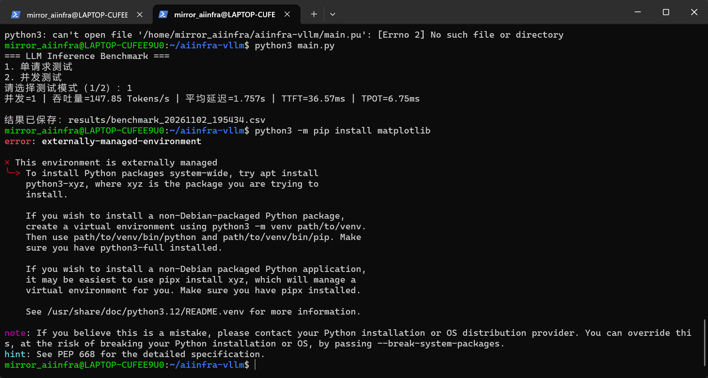
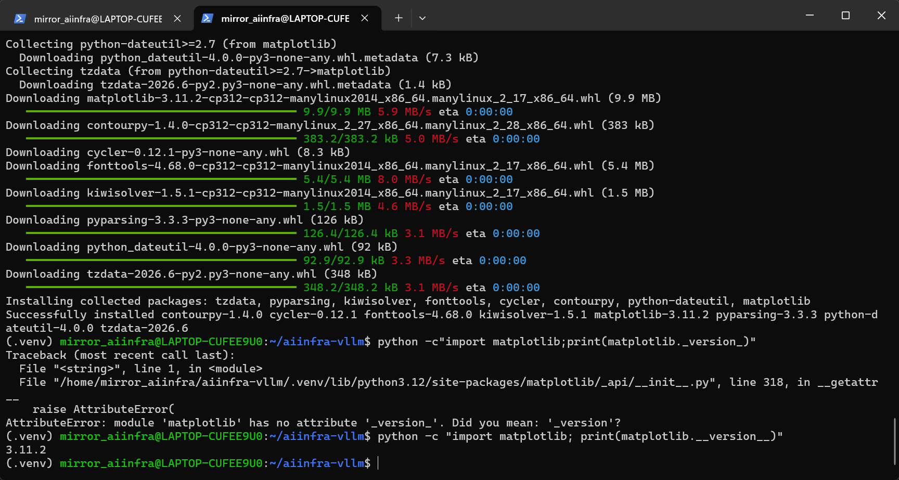
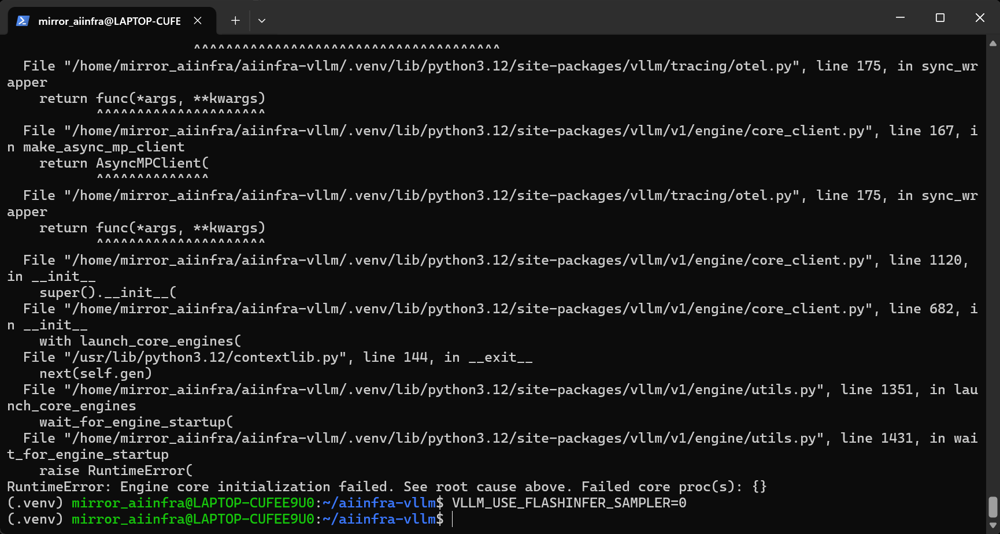
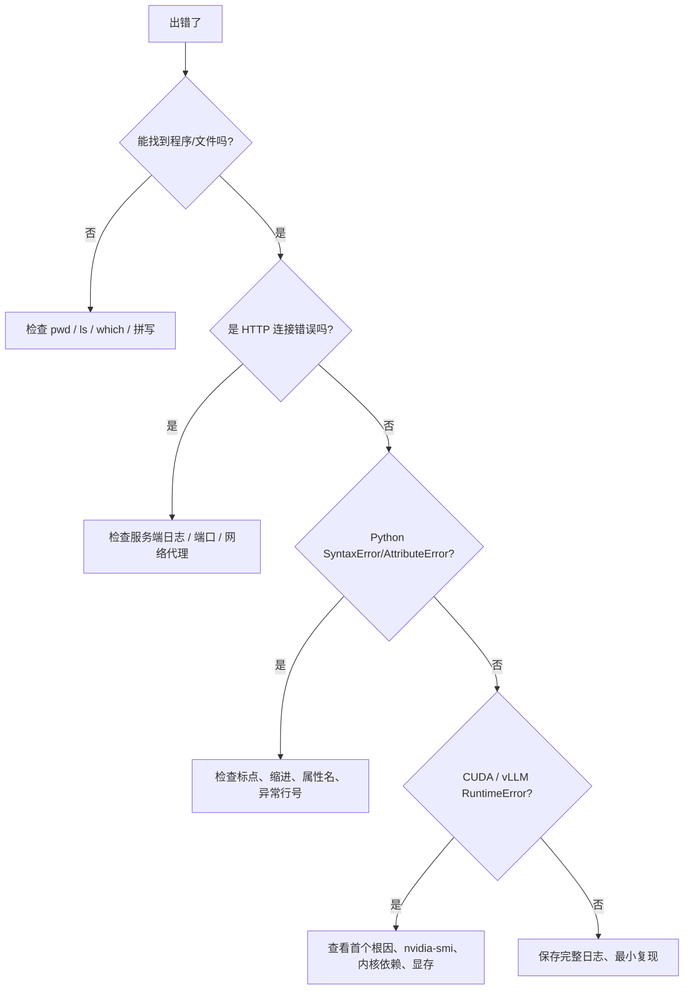

# 05｜真实报错案例库：从报错到系统理解

> [!tip] 排错四步法
> **看第一条有意义的异常 → 判断发生的层（Shell / Python / 网络 / GPU / 服务）→ 最小验证 → 修改后重新验证**。长 Traceback 的末行不一定是根因，尤其 `Engine core initialization failed` 只是最终结果。

| 案例 | 看到的现象 | 根因 | 如何修 |
|---|---|---|---|
| 01 | `cd~`、`cd-aiinfra-vllm: command not found` | `cd` 与参数缺空格 | `cd ~/aiinfra-vllm` |
| 02 | `cd /aiinfra-vllm: No such file` | 根目录 `/` ≠ 家目录 `~` | 使用 `~/aiinfra-vllm` |
| 03 | `benchmark.py: [Errno 2] No such file` | Nano 中未保存文件 | `Ctrl+O` → Enter → `Ctrl+X`，`ls -l` 验证 |
| 04 | `SyntaxError invalid character '，' U+FF0C` | 代码混入全角中文逗号 | 换英文 `,` |
| 05 | `.pu` 找不到文件 | 后缀 `.pu` 输入错误 | `python main.py` |
| 06 | `matplotlib._version_` 报 AttributeError | 双下划线写成单下划线 | `matplotlib.__version__` |
| 07 | `externally-managed-environment` | Ubuntu 管理系统 Python，PEP 668 保护 | 激活 `.venv` 再 `python -m pip install` |
| 08 | curl Microsoft 成功 / HF 失败 | 目标网络路径 / WSL 代理不可达 | 检查 WSL 代理；Mirrored + autoProxy 后重测 |
| 09 | vLLM 一启动就退出，`couldn't find config.json` | 本地缓存无模型，HF 无法访问 | 修网络或使用完整本地模型目录 |
| 10 | vLLM `Could not find nvcc` | FlashInfer sampler JIT 路径需要 CUDA 编译能力 | 本次使用 `VLLM_USE_FLASHINFER_SAMPLER=0 vllm serve ...` 绕过 |
| 11 | 独立输入 `VLLM_USE_FLASHINFER_SAMPLER=0` 仍报错 | 变量未导出给后续命令 | 同一行 `VAR=0 vllm serve ...` 或 `export` |
| 12 | `curl: (7) Failed to connect localhost:8000` | 服务尚未监听 / 已退出 | 看服务端是否 `Application startup complete.` |
| 13 | `KeyboardInterrupt` | 用户按下 Ctrl+C 中断 | 如果是主动停止，属于预期，不是安装失败 |
| 14 | Windows/微信文件突然拖不了 | Windows 拖放交互状态异常（只能推测） | 一次 `Esc` 即恢复；不代表 NVIDIA 驱动故障 |
| 15 | `Ctrl+V` 在一个窗口不好用 | 不同 Terminal 的快捷键配置不同 | 尝试 `Ctrl+Shift+V` / 右键；与 Ubuntu 本身无关 |

## 精选截图 1：文件不存在



**学到**：能打开 Nano ≠ 一定保存到磁盘。先 `ls -l benchmark_stream.py` 再运行，避免把文件问题误判为 Python 问题。

## 精选截图 2：中文逗号



错误例子：

```python
for concurrency in [1, 2, 4， 8]:  # 这里是全角逗号
    pass
```

正确：

```python
for concurrency in [1, 2, 4, 8]:
    pass
```

Unicode 字符在字符串里可以正常使用；但 Python 的标点语法要求对应的 ASCII 符号。

## 精选截图 3：PEP 668



```bash
source ~/aiinfra-vllm/.venv/bin/activate
python -m pip install matplotlib
```

**不是安装失败，而是安装位置错误。** 请不要为了省事加 `--break-system-packages`。

## 精选截图 4：Matplotlib 已安装但属性写错



`Successfully installed ...` 已经证明包安装成功，后面的 `AttributeError` 是**运行代码错误**，两者要分清。

## 精选截图 5：模型下载 / 内核初始化



成功启动至少要看到服务端监听与应用启动完成，不能只凭欢迎 banner 判断成功；对 `nvcc` 的报错，要区分 driver/runtime/toolkit/compiler 的层次。

## Debug 速查决策树



> [!important] 面试加分点
> “碰到 vLLM 不能启动”不应只说“我装了一个库解决了”。应该说清：**现象、定位证据、调用层、替代方案、验证信号**。这比报最终吞吐量数字更体现工程意识。
