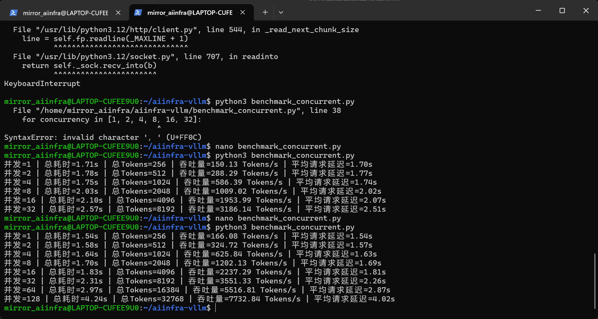

# 06｜实验记录与分析：把故事变成证据

## 1. 把不同实验分开，不混淆条件

### Windows Transformers 基线

| 场景 | 结果 | 已知条件 |
|---|---|---|
| 54 tokens 测试 | 均值 13.29 tokens/s（预热后） | 2 warmup + 5 repeats |
| 约 348 tokens | 均值 14.59 tokens/s；23.865 s | Windows、Transformers `generate`；具体输入上下文不同 |

### vLLM 单请求（不同日期/阶段数据，不能合并当一套）

| 场景 | 结果 | 条件说明 |
|---|---|---|
| 早期 `benchmark.py` | 189.14 ± 3.99 tokens/s | 371 tokens / 次，端到端时间；2 warmup + 5 repeat |
| `benchmark_stream.py` | TTFT 55.7 ms；TPOT 5.29 ms | 371 tokens / 次；客户端 SSE |
| 统一平台（后来一轮） | 151.07 ± 5.90 tokens/s | 256 tokens 上限，5 次；与 371 tokens 测试不同 |

### 单轮并发压力测试（128 上限那轮）

| 并发数 | Total output tokens | Batch 耗时 (s) | 总吞吐量 (tokens/s) | 平均请求延迟 (s) |
|---:|---:|---:|---:|---:|
| 1 | 256 | 1.54 | 166.08 | 1.54 |
| 2 | 512 | 1.58 | 324.72 | 1.57 |
| 4 | 1024 | 1.64 | 625.84 | 1.63 |
| 8 | 2048 | 1.70 | 1202.13 | 1.69 |
| 16 | 4096 | 1.83 | 2237.29 | 1.81 |
| 32 | 8192 | 2.31 | 3551.33 | 2.26 |
| 64 | 16384 | 2.97 | 5516.81 | 2.87 |
| 128 | 32768 | 4.24 | 7732.84 | 4.02 |

> [!warning] 读图规范
> 吞吐量增长快 ≠ 单个用户变快。到 128 并发时总体产出增加，同时单请求完成等待变长。还不能从此数据断言 GPU 最大容量，也不能把 7732.84 tokens/s 当成每用户 Decode 速度。

### 最终平台测试（独立的一轮）

| 指标 | 并发 1 | 并发 32 |
|---|---:|---:|
| 总输出吞吐量 (tokens/s) | 151.07 | 2392.83 |
| 5 轮吞吐量标准差 | 5.90 | 102.50 |
| 平均请求延迟 | 1.695 s | 3.377 s |
| P95 延迟 | 1.782 s | 3.535 s |
| TTFT | 41.72 ms | 222.64 ms |
| TPOT | 6.48 ms | 12.37 ms |
| 失败请求 | 0 | 0 |

这组数据表明在负载增加时**系统总吞吐量上涨，单个请求的首响应与生成间隔变慢**；相对波动系数 CV：单请求约 3.9%、并发 32 约 4.3%。

## 2. 四类核心指标与统计含义

$$\mathrm{Batch\ Throughput} = \frac{\text{成功请求的输出 token 总数}}{\text{整批结束时间}-\text{整批开始时间}}$$

$$\mathrm{TTFT} = t_{\text{first streamed text}} - t_{\text{request start}}$$

$$\mathrm{TPOT} \approx \frac{t_{\text{last output}} - t_{\text{first output}}}{N_{\text{output}}-1}$$

$$\mathrm{CV} = \frac{\mathrm{sample\ std}}{\mathrm{mean}}$$

- **TTFT** 是体验上“多久开始吐字”。
- **TPOT** 是“开始后平均多久吐一个 token”，并不等于每个 token 的真实 kernel 时长。
- **Latency** 是“完整等待多久”；测量边界要写清楚“最后一个文本块”还是“HTTP 完整结束”。
- **P95** 是排序后的位置统计，适合关注慢请求。样本越少，估计越不稳定。

## 3. 不能过度解读的四件事

1. **加速比不可直接确认**：`189.14/14.59≈12.96` 的模型和 GPU 一致，但 Windows / WSL、Prompt、max tokens、采样与时钟边界不同。只能描述为“观察值之比”，不是严格归因。
2. **`max_tokens` 不保证输出长度**：回答可能提早 EOS，或者由于长度上限 `finish_reason=length` 截断。在固定负载的压测中，明确设置输出长度有用，但不能替代真实对话分布。
3. **Prompt 相似且前缀重复**：历史并发脚本用 `用户{i}：同一问题`，vLLM 可能使用 prefix caching。重复测试在已有缓存与热状态下进行，可能高估对真实独立 Prompt 的吞吐量。严格对比应**关闭或控制 prefix caching**，并考虑不同输入长度分布。
4. **客户端也可能成为瓶颈**：Python 线程数、JSON 解析、HTTP 请求创建、WSL 的系统负载都会影响“客户端测到的速度”；高并发时不应假设全部是 GPU 限制。

## 4. 下一轮严谨实验的设计

| 变量 | 建议 |
|---|---|
| 模型 / 分词器 | 同一权重 revision、同一 tokenizer、同一 dtype |
| 推理设置 | temperature=0，固定输入输出 token 目标 |
| 缓存 | 记录 prefix caching 开关与是否预热 |
| 服务端 | vLLM 版本、`--max-num-seqs`、GPU 显存预算、CUDA / driver |
| 客户端 | 记录请求数、并发上限、超时、失败率 |
| 指标 | client TTFT/TPOT、P50/P95/P99、request/s、output tokens/s |
| 对比 | 相同硬件/平台/输入分布/输出长度，以多次实验统计区间 |

**真正的“系统瓶颈”应该通过 GPU Util、SM 占用、显存带宽、KV Cache 使用率、请求排队时间等指标联合判断**，而不是仅看一条吞吐曲线。

## 5. 官方指标口径 / 可扩展

- [vLLM Benchmark CLI](https://github.com/vllm-project/vllm/blob/main/docs/benchmarking/cli.md) 对 TTFT/TPOT/ITL 的定义和客户端测量位置有说明。
- [vLLM Production Metrics](https://github.com/vllm-project/vllm/blob/main/docs/usage/metrics.md) 文档说明 `/metrics` 可提供服务运行期的指标。
- 推荐后续与官方 `vllm bench serve` 做交叉检验，不把自己的学习脚本冒充生产级基准框架。
