# 08｜截图图鉴与复盘清单

> [!info] 图片说明
> 这些图片是从本次会话中可访问的原始截图挑选复制来的**真实证据**，保留了当时的操作界面和报错。部分较早的 Windows 安装截图未能完整对齐原始会话，不编造。发 GitHub 前请人工检查截图中的账户、用户名和本地路径。

## A. 按阶段查看

| 阶段 | 截图 | 学习重点 |
|---|---|---|
| WSL2 入门 | 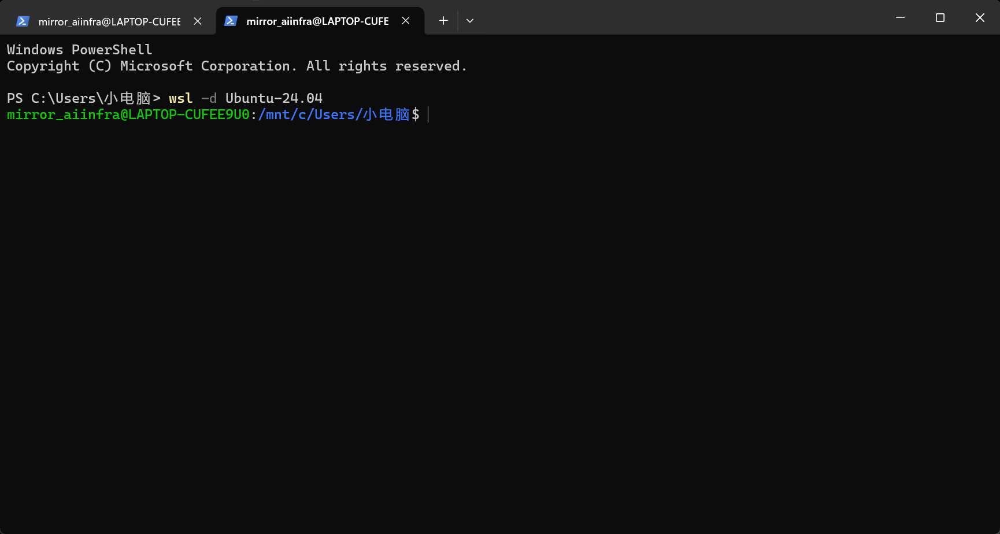 | PowerShell 进入 Ubuntu；当前目录是 Windows 挂载路径 |
| vLLM 失败 | 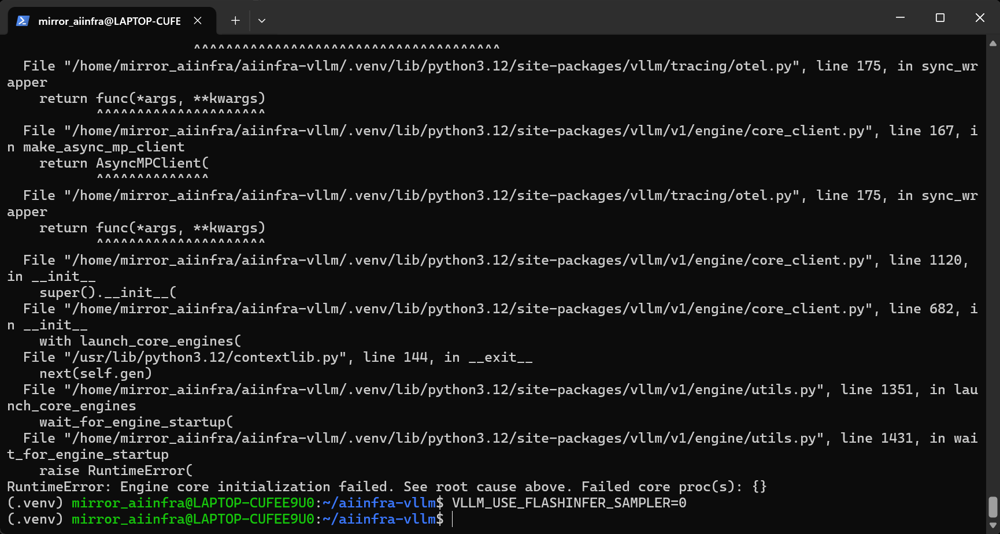 | 不能只看 banner；追踪初始化失败根因 |
| API 首次成功 | 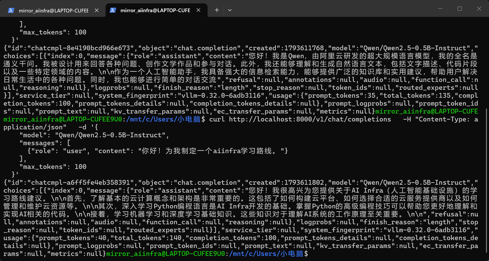 | JSON、completion_tokens、finish_reason |
| 单次耗时 | 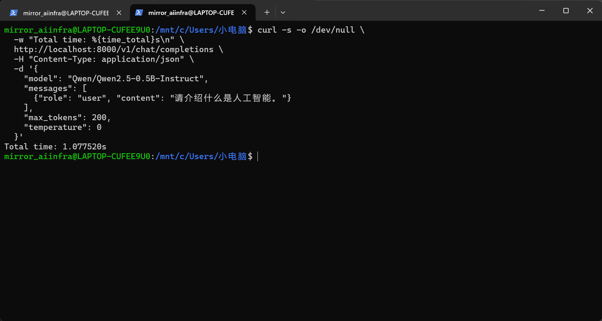 | `curl -w` 与 `/dev/null` |
| 编辑器 | 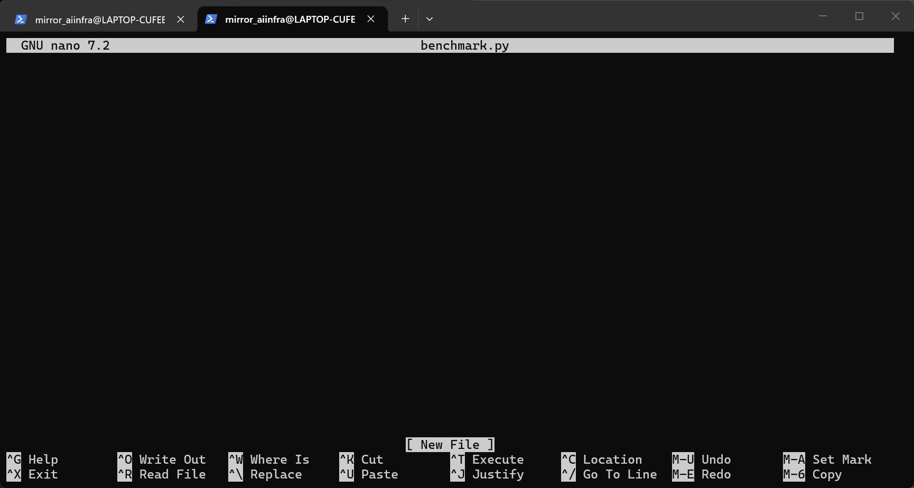 | Nano 新文件与保存 |
| 文件找不到 | 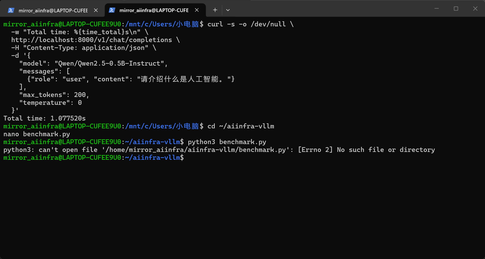 | 验证保存成功的重要性 |
| 5 次基准 | 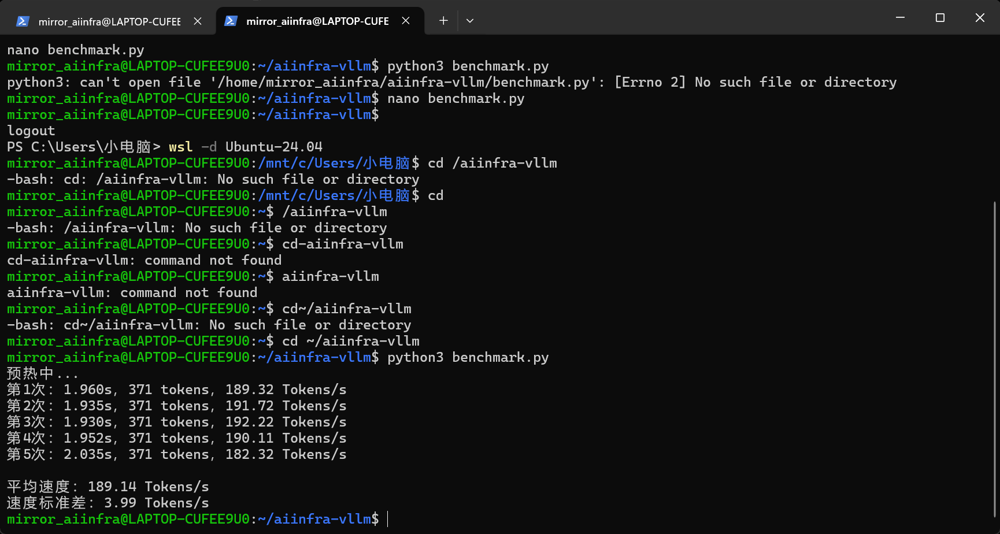 | 189.14 Tokens/s；不要误读为 GPU 理论峰值 |
| TTFT / TPOT | 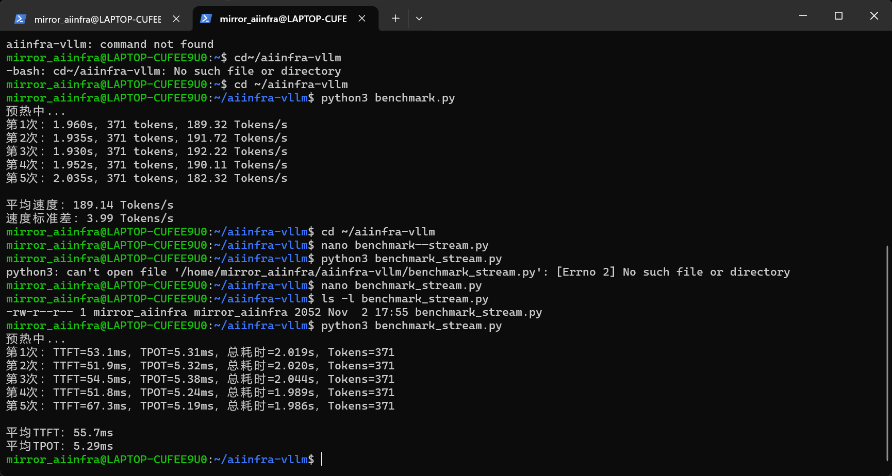 | 55.7 ms / 5.29 ms |
| 并发 8 | 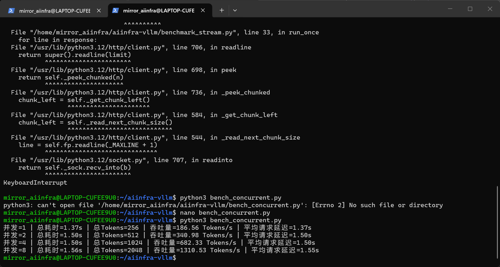 | total throughput vs latency |
| 中文标点错误 | 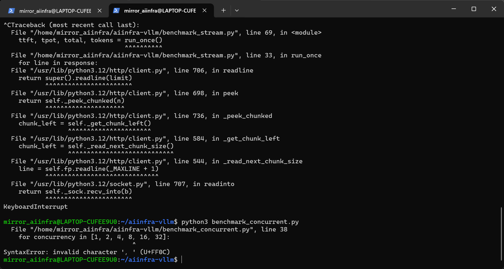 | 语法与 Unicode |
| 并发 32 | 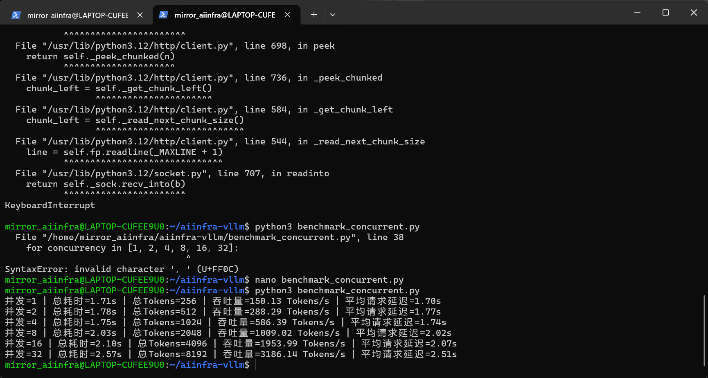 | 带宽/调度收益趋势 |
| 并发 128 | 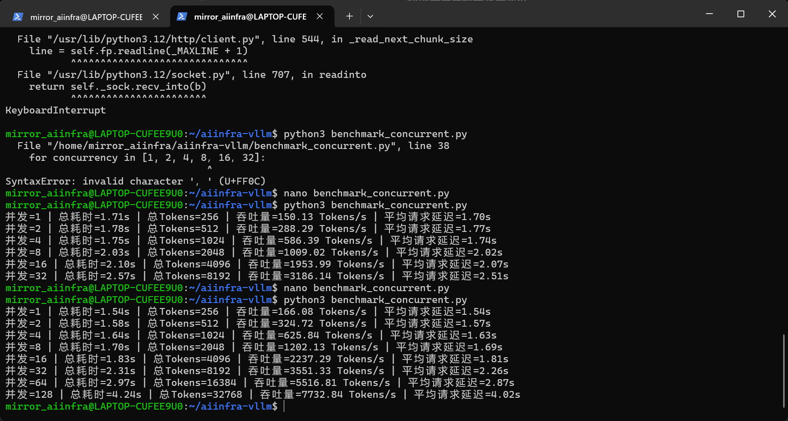 | 7732.84 total tokens/s |
| 主菜单 + CSV | 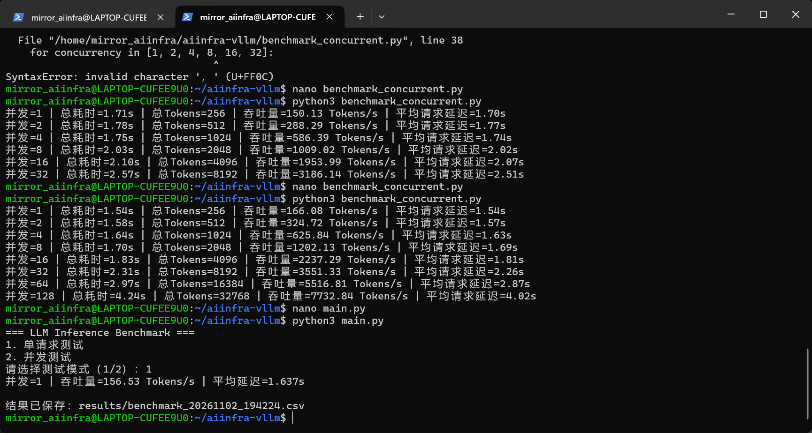 | 从单脚本到平台 |
| CSV TTFT / TPOT | 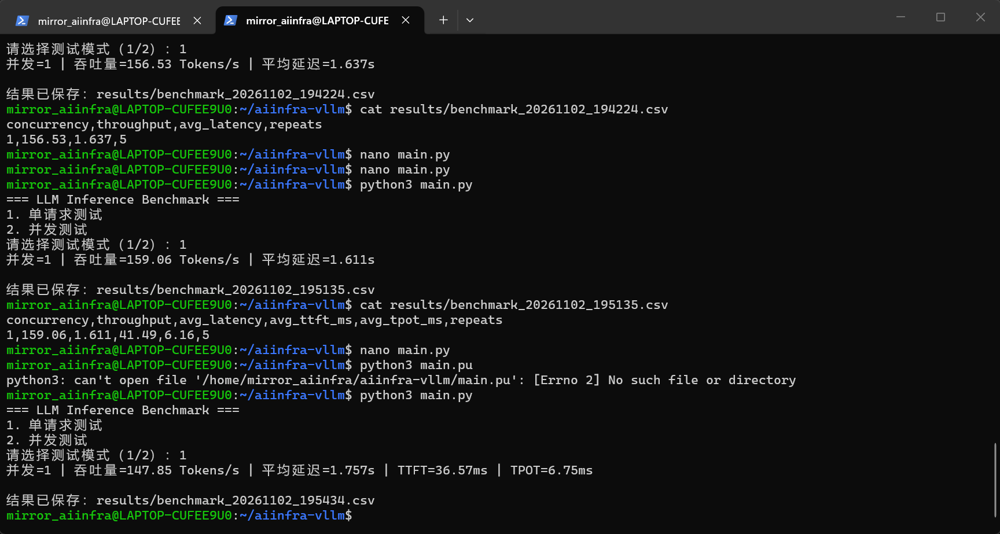 | 多指标结构化存储 |
| pip 环境保护 | 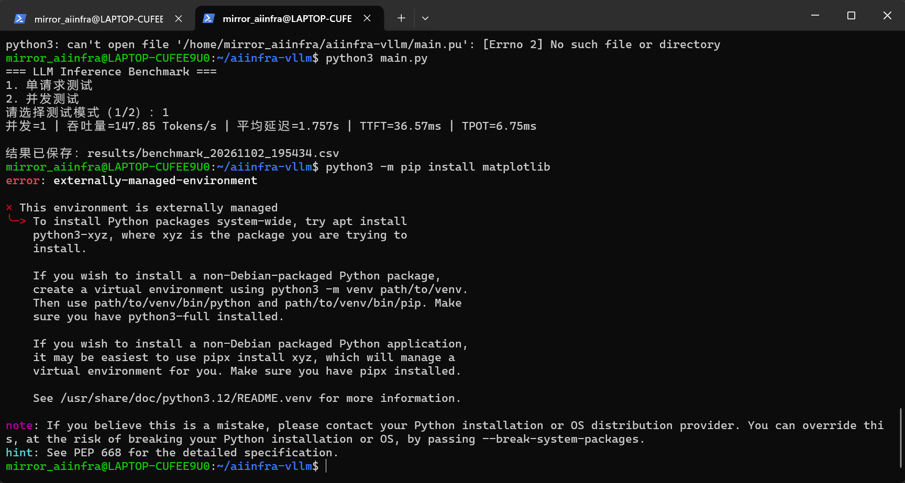 | 虚拟环境隔离 |
| matplotlib 成功 | 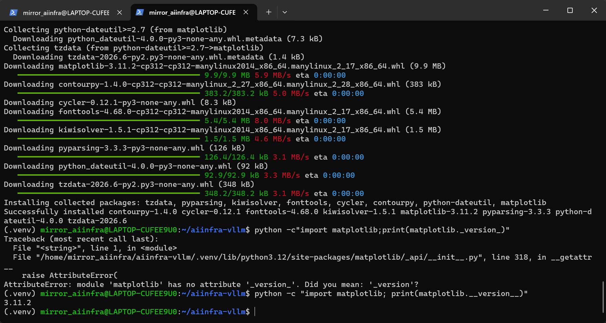 | `__version__` dunder |
| 绘图成果 | 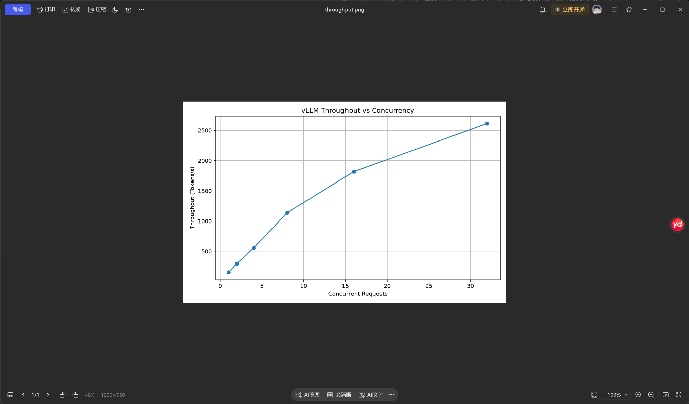 | 自动画图 |
| 平台终版输出 | 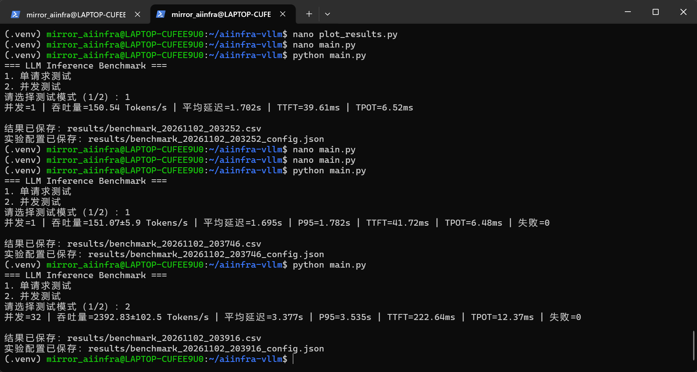 | P95、标准差、CSV 与配置 JSON |

## B. 一页自测（先自己回答）

- [ ] 为什么 Windows 下载过 Qwen，WSL vLLM 仍提示找不到模型？
- [ ] 为什么 `127.0.0.1:7890` 在 NAT WSL 中曾不能直达 Windows 代理？
- [ ] `python`、`python3`、`.venv` 与 `which python` 的关系是什么？
- [ ] `Ctrl + O` 保存后还需要按什么确认？
- [ ] `with` 和 `ThreadPoolExecutor` 各自负责哪部分？
- [ ] `stream=True` 解决了什么计时问题？
- [ ] 为什么 `max_tokens=256` 不保证恰好生成 256？
- [ ] 128 并发 7.7k Tokens/s 是“每个用户”还是“系统整体”？
- [ ] 为什么不能把 13× 当作严格的引擎加速比？
- [ ] P95 与平均值不同，怎样从 100 个延迟中计算？
- [ ] 对照 CSV，能手算一个 throughput 吗？
- [ ] 现在不看文档，能解释服务端与客户端为什么使用两个终端吗？

## C. 复盘计划（推荐 Obsidian 勾选）

**Day 1**：从零手打 8 个 Linux 命令，读懂 HTTP + JSON。  
**Day 2**：只看 `src/main.py`，自己写出 `send_request()` 的数据流。  
**Day 3**：亲手将输出长度设为 128/256，对比请求耗时和截断。  
**Day 4**：设计一个并发 1/4/8/16 的实验，并解释总吞吐量。  
**Day 5**：在不看代码的情况下描述 P95、TTFT、TPOT。  
**Day 6**：整理一次真实故障定位报告，写成“症状-根因-验证”。  
**Day 7**：把 README 的系统架构画给自己看，准备 2 分钟讲给面试官。
